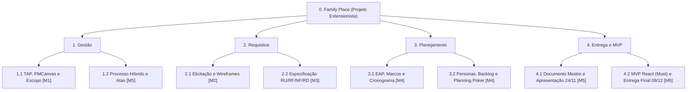
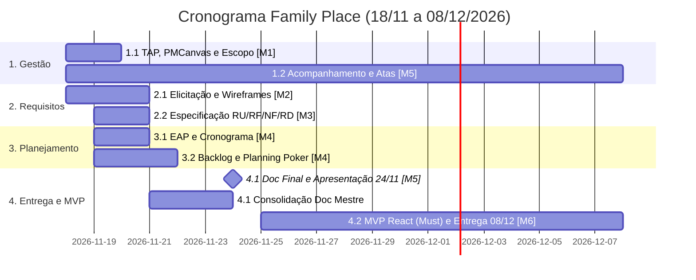

# Documento Final do Projeto Extensionista: Family Place

**Disciplinas Integradas:** Engenharia de Software (Prof. Fernando Marlon Soares Figueiredo) & Front-end (React)  
**Repositório:** `family-pet` ([https://github.com/pierressc/family-pet](https://github.com/pierressc/family-pet))  
**Versão Atual:** `1.2` · **Data:** `18/11/2026`  

---

## Controle de Versões

| Versão | Data | Responsável | Descrição das Alterações |
| :--- | :--- | :--- | :--- |
| `0.1` | 18/11/2026 | Pierre Cavalcanti | Estrutura inicial do documento mestre, identificação da equipe e definição do processo híbrido (Seções 1 e 2). |
| `0.2` | 18/11/2026 | Pierre Cavalcanti & `[Integrante 2]` | Consolidação do TAP, PMCanvas, escopo negativo, viabilidade, plano de elicitação e wireframes de baixa fidelidade (Seções 3 e 4). |
| `0.3` | 18/11/2026 | `[Integrante 2]` & `[Integrante 3]` | Especificação versionada (`RU`, `RF`, `NF`, `RD`) com MoSCoW, EAP hierárquica, marcos verificáveis e cronograma Sommerville +50% (Seções 5 e 6). |
| `0.4` | 18/11/2026 | `[Integrante 4]` & `[Integrante 5]` | Personas, Épicos, Histórias (`H01–H15`), DoD, Quadro Kanban, sessão de Planning Poker, Matriz de Rastreabilidade e Declaração de IA (Seções 7, 8 e 9). |
| `1.0` | 18/11/2026 | `[Integrante 5 - Qualidade]` & Equipe | Revisão integral de coerência entre artefatos, verificação de rastreabilidade (0 lacunas) e fechamento do pacote documental para apresentação em 24/11/2026. |
| `1.1` | 18/11/2026 | Pierre Cavalcanti & Equipe | Implementação e validação do MVP funcional em React (`RF001–RF009`, 31 pts *Must*) e atualização do Quadro Kanban e da Seção 8. |
| `1.2` | 18/11/2026 | Pierre Cavalcanti & Equipe | Separação física entre `mvp/` (Apresentação 1 — 24/11) e `projeto-completo/` (Apresentação 2 — React + Banco de Dados SQLite cobrindo `RF001–RF014`). |

---

## Sumário

1. [Identificação do Projeto e da Equipe](#1-identificação-do-projeto-e-da-equipe)
2. [Processo de Desenvolvimento Adotado](#2-processo-de-desenvolvimento-adotado)
3. [TAP, Escopo e Estudo de Viabilidade](#3-tap-escopo-e-estudo-de-viabilidade)
4. [Elicitação de Requisitos e Protótipos de Baixa Fidelidade](#4-elicitação-de-requisitos-e-protótipos-de-baixa-fidelidade)
5. [Especificação de Requisitos](#5-especificação-de-requisitos)
6. [EAP, Marcos e Cronograma](#6-eap-marcos-e-cronograma)
7. [Backlog, Personas, Histórias de Usuário e Estimativas](#7-backlog-personas-histórias-de-usuário-e-estimativas)
8. [MVP em React (Opcional — Aguardando Autorização)](#8-mvp-em-react-opcional--aguardando-autorização)
9. [Matriz de Rastreabilidade, Referências, Anexos e Declaração de Uso de IA](#9-matriz-de-rastreabilidade-referências-anexos-e-declaração-de-uso-de-ia)

---

## 1. Identificação do Projeto e da Equipe

> **Responsável pela escrita desta seção:** Pierre Cavalcanti (Coordenação)

### 1.1. Dados Gerais do Projeto
- **Nome do Projeto:** **Family Place** *(repositório `family-pet`)*
- **Natureza:** Projeto Extensionista com impacto comunitário real, unificando as disciplinas de **Engenharia de Software** (documentação completa e artefatos visuais) e **Front-end (React)** (aplicação web responsiva em andamento neste semestre).
- **Público Comunitário Atendido:** Famílias com crianças pequenas, tutores de animais de estimação (pets), pessoas idosas, Pessoas com Deficiência (PCD) e comércios/estabelecimentos locais inclusivos.
- **Calendário Integrado:**
  - **18/11 a 20/11/2026:** Consolidação interna da documentação e pacote visual.
  - **24/11/2026:** Apresentação cronometrada de Engenharia de Software (7 min apresentação + 1 min tolerância + 4 min perguntas individuais).
  - **25/11 a 1ª semana de dezembro / 08/12/2026:** Desenvolvimento do MVP em React (após autorização) e entrega final consolidada do semestre.

### 1.2. Equipe, Papéis e Responsabilidades por Seção

| Papel no Projeto | Integrante | Responsabilidades Principais | Seções Sob Responsabilidade |
| :--- | :--- | :--- | :--- |
| **Coordenação** | Pierre Cavalcanti | TAP, PMCanvas, prazos, integração Git e acompanhamento semanal | Seção 1, Seção 2, Seção 3 e Seção 8 |
| **Requisitos** | `[Integrante 2 - Nome]` | Plano de elicitação, aplicação (Forms/entrevistas), wireframes e especificação | Seção 4 e Seção 5 |
| **Planejamento** | `[Integrante 3 - Nome]` | EAP hierárquica, marcos verificáveis e cronograma (Regra de Sommerville) | Seção 6 |
| **Backlog** | `[Integrante 4 - Nome]` | Personas, histórias de usuário, DoD, quadro Kanban e Planning Poker | Seção 7 |
| **Qualidade** | `[Integrante 5 - Nome]` | Revisão cruzada, matriz de rastreabilidade, atas e declaração de IA | Seção 9 e Revisão Geral |

> *Nota:* Os papéis dividem a responsabilidade pela condução e redação, mas **todos os integrantes participaram da revisão e dominam integralmente o documento** para a arguição individual.

---

## 2. Processo de Desenvolvimento Adotado

> **Responsável pela escrita desta seção:** Pierre Cavalcanti (Coordenação)

### 2.1. Modelo Escolhido: Híbrido (Scrum + Kanban)
A equipe adotou um **processo híbrido combinando cadência iterativa do Scrum com fluxo visual contínuo do Kanban**.

### 2.2. Justificativa Frente ao Contexto (Perguntas-Guia)
1. **O público atendido acompanha toda semana?** Não de forma diária ou em rituais formais contínuos, pois pais, tutores, idosos, PCDs e comerciantes locais possuem rotinas próprias. Por isso, a equipe concentra validações em janelas objetivas (formulário online + entrevistas curtas + validação de wireframes).
2. **Os requisitos podem mudar no meio do caminho?** Sim. O contato com a comunidade e a transição entre a especificação (Engenharia de Software) e a implementação em React (Front-end) podem exigir ajustes de prioridade — o que é absorvido facilmente pelo backlog priorizado com MoSCoW.
3. **Há prazo fixo e equipe pequena?** Sim. Trata-se de equipe acadêmica (até 5 pessoas) com marcos fixos e curtos (**24/11** para documentação e **08/12** para fechamento final), exigindo controle rigoroso de escopo.
4. **Papéis e rituais adequados:** O modelo híbrido evita burocracia excessiva do Scrum puro, mantendo iterações semanais para metas e quadro Kanban para transparência de progresso por pontos.

### 2.3. Aplicação na Prática
- **Cadência em duas macroetapas (Sprints):**
  - *Iteração 1 (18/11–24/11):* Fundação, Elicitação, Especificação, Planejamento, Wireframes e Documento Mestre.
  - *Iteração 2 (25/11–08/12):* Implementação do MVP em React focado nas histórias *Must* (`RF001–RF009`).
- **Fluxo Kanban:** Quadro visual com colunas *Backlog*, *Em andamento* e *Pronto*, exibindo a pontuação Fibonacci e o percentual concluído em cada acompanhamento.
- **Rituais:** Reuniões curtas de alinhamento (com ata registrada em [atas-reuniao.md](artefatos/atas-reuniao.md)), sessão única de Planning Poker para estimativa consensual e revisão cruzada de qualidade antes de cada marco.

### 2.4. Limitações Assumidas pelo Grupo
- Disponibilidade parcial dos integrantes por conciliação com demais disciplinas do semestre.
- Dependência do tempo de resposta da comunidade externa na fase de elicitação.
- Escopo técnico intencionalmente enxuto no MVP React (sem gateway de pagamento ou aplicativo nativo) para garantir entrega funcional e acessível dentro do prazo semestral.

---

## 3. TAP, Escopo e Estudo de Viabilidade

> **Responsável pela escrita desta seção:** Pierre Cavalcanti (Coordenação)  
> **Artefatos de Apoio Obrigatórios:** [pmcanvas-family-place.md](artefatos/pmcanvas-family-place.md) · [pmcanvas-family-place.svg](artefatos/pmcanvas-family-place.svg)

### 3.1. Termo de Abertura do Projeto (TAP)

#### Propósito e Justificativa
O **Family Place** surge para resolver uma dor comunitária concreta: famílias com crianças pequenas, tutores de pets, idosos e Pessoas com Deficiência (PCD) frequentemente evitam ou enfrentam constrangimentos em passeios por falta de informações confiáveis e detalhadas sobre infraestrutura inclusiva (trocadores, rampas, banheiros adaptados, nível de ruído, regras para animais de estimação). Paralelamente, estabelecimentos locais que investem em acolhimento não contam com um canal direcionado para divulgar esses diferenciais sem pagar comissões de plataformas de delivery.

#### Objetivos SMART
- **`OBJ1` (Catálogo Inclusivo Validado):** Estruturar e validar a base inicial de estabelecimentos inclusivos com filtros combinados nos 4 pilares, atingindo pelo menos **15 estabelecimentos mapeados** no protótipo/MVP até **01/12/2026**.
- **`OBJ2` (Elicitação Comunitária):** Aplicar **2 técnicas distintas de elicitação** (mínimo **20 respostas** em questionário Google Forms e **3 entrevistas semiestruturadas** com frequentadores e gestores locais), derivando 100% dos requisitos essenciais até **20/11/2026**.
- **`OBJ3` (Avaliação Multicritério e Favoritos):** Especificar e prototipar em baixa fidelidade **100% dos fluxos essenciais** de avaliação nos 4 pilares independentes e listas de favoritos por critério até **20/11/2026**.
- **`OBJ4` (Entrega Acadêmica Integrada):** Consolidar o pacote documental completo para apresentação em **24/11/2026** e entregar o MVP funcional em React das histórias *Must* na **1ª semana de dezembro** (fechamento final em **08/12/2026**).

#### Stakeholders, Papéis e Expectativas

| Grupo | Stakeholder | Papel | Canal de Escuta | Expectativa Principal |
| :--- | :--- | :--- | :--- | :--- |
| **Envolvidos (Internos)** | Equipe Acadêmica (5 papéis) | Especificação, planejamento, documentação e desenvolvimento React | Reuniões semanais + Kanban + GitHub | Entregar documentação coerente em 24/11 e MVP funcional até 08/12 |
| **Envolvidos (Internos)** | Prof. Fernando Marlon (Eng. SW) | Orientador e avaliador da documentação extensionista | Acompanhamentos semanais e apresentação em 24/11 | Documentação completa, rastreável, sem jargões e com artefatos visuais |
| **Envolvidos (Internos)** | Docente de Front-end (React) | Avaliador da aplicação web React | Apresentação na 1ª semana de dezembro | Aplicação React responsiva, acessível e funcional |
| **Interessados (Externos)** | Famílias com crianças, tutores de pets, idosos e PCDs | Usuários finais (Clientes) da comunidade local | Questionário Google Forms + Entrevista + Validação de wireframes | Encontrar com rapidez e confiabilidade locais adequados antes de sair de casa |
| **Interessados (Externos)** | Gestores de estabelecimentos locais | Parceiros ofertantes (cafés, restaurantes, parques/comércios) | Entrevista semiestruturada | Divulgar estrutura inclusiva, vitrine e cupons, recebendo contato direto sem taxas |

#### Gerente do Projeto e Nível de Autoridade
- **Gerente do Projeto (Coordenação):** Pierre Cavalcanti.
- **Autoridade:** Coordenar prazos internos, conduzir rituais Kanban, aprovar mudanças de escopo junto à equipe, consolidar versões no repositório GitHub e garantir conformidade com a rubrica da disciplina. Decisões que alterem requisitos *Must* exigem consenso da equipe.

#### Marcos e Cronograma em Alto Nível
- **18/11 – 20/11/2026:** TAP, PMCanvas, Elicitação, Wireframes, Requisitos, EAP, Cronograma e Backlog.
- **24/11/2026:** Apresentação e entrega do Pacote Documental (Engenharia de Software).
- **25/11 – 04/12/2026:** Desenvolvimento do MVP em React (Front-end — após autorização).
- **08/12/2026:** Fechamento e entrega final consolidada do semestre.

#### Premissas, Restrições, Riscos e Orçamento
- **Premissas:** Participação do público comunitário nas pesquisas; estabelecimentos já operam WhatsApp ou site oficial para atendimento externo; uso exclusivo de ferramentas gratuitas.
- **Restrições:** Prazo fixo semestral (24/11 e 08/12); orçamento R\$ 0,00; observância obrigatória à LGPD (consentimento e anonimização).
- **Riscos em Alto Nível:** (1) Baixa adesão no questionário ➔ mitigado com formulário curto e abordagem direta; (2) Atraso na passagem da documentação ao React ➔ mitigado pela margem de Sommerville (+50%) e foco estrito nas histórias *Must*; (3) Incoerência entre documentos ➔ mitigado pela Matriz de Rastreabilidade.
- **Orçamento Preliminar:** **R\$ 0,00** (uso de GitHub, Markdown/CSV/SVG, draw.io, Google Forms, Figma/SVG e React).
- **Subprodutos:** Documento Mestre Único, PMCanvas, Instrumentos de Elicitação, Wireframes, Planilha de Requisitos, EAP, Cronograma Gantt, Quadro Kanban, Matriz de Rastreabilidade e MVP React.

---

### 3.2. Delimitação de Escopo (Positivo e Negativo)

#### O que o Family Place FAZ (Escopo Positivo)
1. **Busca com filtros combinados** por categoria e múltiplas tags dos 4 pilares (`RF001`).
2. **Avaliação multicritério de 1 a 5 estrelas em 4 pilares independentes:** Estrutura Infantil (Kids), Acessibilidade e Conforto (PCD e Idosos), Receptividade Pet (Pet Friendly) e Atendimento/Custo-Benefício (`RF003`, `RF004`, `RF009`).
3. **Listas de favoritos personalizadas por critério**, permitindo agrupar locais por companhia (`RF005`).
4. **Gestão do perfil do estabelecimento**, incluindo marcação de comodidades (*tags*) e vitrine informativa com destaque para itens *"Favoritos da Casa"* (`RF007`).
5. **Redirecionamento direto para contato** via WhatsApp, site oficial ou formulário simples de solicitação de contato (`RF008`).
6. **Comunidade e Fidelidade (Prioridade *Should*):** Seguir estabelecimentos, Timeline com texto curto (até 280 caracteres) + 1 imagem + tag de categoria (`RF010`, `RF011`) e Clube de Cupons gratuitos (`RF012`).
7. **Assistente Virtual / Chatbot de Recomendação (Prioridade *Could*):** Sugestão de locais por linguagem natural ou fluxo guiado (`RF013`).

#### O que o Family Place NÃO FAZ (Escopo Negativo Explícito)
1. **NÃO realiza processamento de pagamentos online, checkout financeiro ou intermediação de vendas** (`RD002`, `RF015`).
2. **NÃO realiza delivery ou logística própria de entregas.**
3. **NÃO oferece avaliação individual de cada produto ou prato do cardápio** (substituída pelos destaques *"Favoritos da Casa"* na vitrine para evitar complexidade excessiva no MVP).
4. **NÃO possui aplicativo mobile nativo (Android/iOS)** nesta entrega semestral (a plataforma é web responsiva de 360 px a 1920 px).

#### Números Declarados, Limitações e Fatores Mitigantes
- Meta inicial de **15 estabelecimentos** mapeados, suporte testado para até **1.000 estabelecimentos** na filtragem (`NF004`) e limite de **280 caracteres + 1 imagem** por publicação na Timeline (`RD004`).
- Limitações conhecidas (ausência de validação presencial pela equipe em cada comércio) são mitigadas por avaliações multicritério dos próprios usuários e botão de sinalização comunitária (`RF014`).

---

### 3.3. Estudo de Viabilidade

| Dimensão | Análise |
| :--- | :--- |
| **Utilidade para a Comunidade** | Alta. Atende simultaneamente 4 públicos frequentemente negligenciados por guias genéricos (crianças, pets, idosos e PCDs) e fortalece o comércio local sem cobrar comissões. |
| **Viabilidade Técnica e Prazo** | Viável. A stack **React** no Front-end atende perfeitamente aos fluxos essenciais até a 1ª semana de dezembro / 08/12, uma vez que funcionalidades complexas de pagamento ficaram fora do escopo e o Chatbot foi priorizado como *Could*. |
| **Integração com o que o Público já Usa** | Totalmente compatível. Em vez de impor novo checkout aos comércios locais, o sistema encaminha o cliente diretamente para o **WhatsApp** ou **site oficial** que o estabelecimento já utiliza no dia a dia. |

**Recomendação Final do Estudo de Viabilidade:** **O desenvolvimento deve prosseguir**, priorizando no MVP React exclusivamente as 9 histórias classificadas como *Must (Essencial)* e mantendo os módulos *Should* e *Could* especificados para evolução incremental.

---

## 4. Elicitação de Requisitos e Protótipos de Baixa Fidelidade

> **Responsável pela escrita desta seção:** `[Integrante 2 - Nome]` (Requisitos)  
> **Artefatos de Apoio Obrigatórios:** [elicitacao-questionario-roteiro.md](artefatos/elicitacao-questionario-roteiro.md) · [wireframes-baixa-fidelidade.svg](artefatos/wireframes-baixa-fidelidade.svg)

### 4.1. Plano de Elicitação (2+ Técnicas Obrigatórias)
Para garantir fidelidade às dores reais da comunidade, foram combinadas **duas técnicas obrigatórias** (e cenários como apoio):
1. **Questionário Estruturado (Google Forms):** Ideal para alcançar um volume maior de frequentadores (pais, tutores, idosos/cuidadores e PCDs) com perguntas fechadas sobre filtros, modelo de nota em 4 pilares, listas de favoritos e preferências de contato.
2. **Entrevista Semiestruturada:** Aplicada a um grupo menor (frequentadores e gestores de comércios locais) para aprofundar contextos reais de uso, dificuldades de acessibilidade e preferências de divulgação sem taxas.

### 4.2. Cuidados Éticos e LGPD
- Solicitação prévia de consentimento explícito antes de qualquer coleta ou registro (`RD001`).
- Nenhuma exposição de nomes pessoais, telefones ou dados sensíveis no documento (uso de códigos `Resp-XX`, `ENT-01`, `ENT-02`, `ENT-03`).

### 4.3. Síntese das Evidências e Requisitos Originados
Os instrumentos completos, roteiros e tabela de registro de campo encontram-se em [elicitacao-questionario-roteiro.md](artefatos/elicitacao-questionario-roteiro.md):
- **Do Questionário (Google Forms):** necessidade de combinar critérios de públicos distintos na mesma busca (`RF001`, `NF004`), preferência por notas separadas em 4 pilares (`RF003`, `RF004`, `RF009`), organização de favoritos por companhia (`RF005`), redirecionamento direto ao WhatsApp/site (`RF008`, `RD002`) e interesse em Timeline/Cupons (`RF010–RF012`) e Chatbot (`RF013`).
- **Das Entrevistas (`ENT-01` a `ENT-03`):** necessidade de contraste alto e fonte legível para idosos e baixa visão (`NF002`), transparência sobre porte de pet e acessibilidade física (`RF002`), e autonomia para o comerciante destacar itens *"Favoritos da Casa"* sem taxa de intermediação (`RF007`, `RD002`).

### 4.4. Protótipos de Baixa Fidelidade (Wireframes)
Os esboços em baixa fidelidade das telas essenciais estão consolidados em [wireframes-baixa-fidelidade.svg](artefatos/wireframes-baixa-fidelidade.svg), cobrindo:
1. **Tela 1 — Busca com Filtros Combinados (`RF001`, `RF003`):** barra de busca + chips combinados (Kids, PCD/Idosos, Pet) + cards exibindo as 4 médias independentes.
2. **Tela 2 — Perfil do Estabelecimento (`RF002`, `RF008`, `RF009`):** notas clicáveis dos 4 pilares, comodidades confirmadas, vitrine *"Favoritos da Casa"*, botões *"Chamar no WhatsApp"* / *"Site Oficial"* e avaliações filtráveis por pilar.
3. **Tela 3 — Publicar Avaliação Multicritério (`RF004`):** seleção obrigatória de 1 a 5 estrelas para cada um dos 4 pilares + comentário opcional.
4. **Tela 4 — Favoritos por Critério (`RF005`):** criação e visualização de listas temáticas (*"Melhores para ir com meu Avô"*, *"Melhores para levar o Cachorro"*, *"Melhores Espaços Kids"*).
5. **Tela 5 — Painel do Estabelecimento (`RF006`, `RF007`):** dados básicos, link WhatsApp/site, checklist de tags inclusivas e vitrine informativa sem checkout.
6. **Tela 6 — Comunidade, Cupons e Assistente Virtual (`RF010–RF013`):** feed de atualizações (texto + 1 imagem + tag), resgate de cupons e fluxo conversacional do chatbot.

---

## 5. Especificação de Requisitos

> **Responsável pela escrita desta seção:** `[Integrante 2 - Nome]` (Requisitos)  
> **Artefato de Apoio Obrigatório:** [requisitos-family-place.csv](artefatos/requisitos-family-place.csv)

Todos os requisitos seguem as regras de engenharia de requisitos da disciplina: identificadores únicos, verbos **"Deve"** (obrigatório) e **"Deveria"** (desejável), ausência de termos vagos ou jargões técnicos e critérios 100% verificáveis.

### 5.1. Rastreamento Requisitos do Usuário (`RU`) ➔ Requisitos do Sistema

| ID RU | Descrição da Necessidade do Usuário | Requisitos Derivados |
| :--- | :--- | :--- |
| **`RU01`** | Como visitante/cliente, preciso encontrar estabelecimentos que atendam simultaneamente às necessidades da minha família (crianças, pets, idosos e PCDs). | `RF001`, `RF002`, `NF001`, `NF004` |
| **`RU02`** | Como usuário, preciso consultar e registrar avaliações detalhadas por pilar para confiar na estrutura real do local antes de sair de casa. | `RF003`, `RF004`, `RF009`, `RD003` |
| **`RU03`** | Como usuário, preciso organizar meus locais favoritos de acordo com quem vai comigo no passeio. | `RF005` |
| **`RU04`** | Como gestor de estabelecimento local, preciso cadastrar meu espaço, destacar comodidades e divulgar produtos/serviços sem depender de intermediação de vendas. | `RF006`, `RF007`, `RF008`, `RD002` |
| **`RU05`** | Como usuário da comunidade, quero acompanhar novidades, eventos e promoções dos meus estabelecimentos preferidos. | `RF010`, `RF011`, `RD004` |
| **`RU06`** | Como membro frequente da comunidade, quero aproveitar benefícios e cupons oferecidos pelos parceiros locais. | `RF012`, `RD004` |
| **`RU07`** | Como usuário com pouca familiaridade com filtros complexos, quero descrever o que procuro em linguagem natural para receber recomendações. | `RF013`, `RF014` |
| **`RU08`** | Necessidades futuras fora da entrega atual (pagamento integrado, delivery próprio, avaliação por item e app nativo). | `RF015` |

### 5.2. Distribuição MoSCoW dos Requisitos Funcionais (`RF001`–`RF015`)

- **Must (Essencial):** 9 requisitos (`RF001` a `RF009`) — **60,0%**
- **Should (Importante):** 3 requisitos (`RF010` a `RF012`) — **20,0%**
- **Could (Desejável):** 2 requisitos (`RF013`, `RF014`) — **13,3%**
- **Won't (Agora não):** 1 requisito agrupador (`RF015`) — **6,7%**

### 5.3. Fichas Detalhadas dos Requisitos Funcionais

| ID | Título | Prioridade | Descrição | Entradas / Pré-condições | Saídas / Pós-condições |
| :--- | :--- | :--- | :--- | :--- | :--- |
| **`RF001`** | Buscar estabelecimentos com filtros combinados | Essencial (Must) | O sistema **deve** permitir que o usuário filtre estabelecimentos combinando simultaneamente categoria e múltiplas tags dos pilares Infantil, Acessibilidade (PCD/Idosos) e Pet Friendly. | Usuário na busca; ao menos 1 filtro ou termo informado. | Lista de locais compatíveis com todos os filtros selecionados e total encontrado. |
| **`RF002`** | Visualizar perfil detalhado do estabelecimento | Essencial (Must) | O sistema **deve** exibir o perfil completo do estabelecimento com endereço, horário de funcionamento, tags de estrutura confirmadas, vitrine informativa e link externo de localização. | Estabelecimento selecionado na busca ou favoritos. | Página de detalhes exibida integralmente com dados atualizados. |
| **`RF003`** | Consultar médias segmentadas nos 4 pilares | Essencial (Must) | O sistema **deve** calcular e exibir a média de 1 a 5 estrelas separadamente para Estrutura Infantil, Acessibilidade e Conforto, Receptividade Pet e Atendimento/Custo-Benefício. | Local com 1 ou mais avaliações publicadas (ou estado "Sem avaliações"). | 4 médias independentes exibidas com 1 casa decimal e contagem de avaliações. |
| **`RF004`** | Publicar avaliação multicritério | Essencial (Must) | O sistema **deve** permitir que o cliente autenticado registre ou atualize sua avaliação atribuindo notas de 1 a 5 estrelas para cada um dos 4 pilares e comentário textual opcional. | Cliente autenticado; 4 notas entre 1 e 5 informadas. | Avaliação registrada e médias do estabelecimento recalculadas imediatamente. |
| **`RF005`** | Gerenciar listas de favoritos por critério | Essencial (Must) | O sistema **deve** permitir que o cliente autenticado crie listas personalizadas de favoritos por critério (ex.: *"Com meu Avô"*, *"Com o Pet"*) e adicione ou remova locais. | Cliente autenticado; nome válido da lista informado. | Listas salvas no perfil do cliente com vinculação independente dos locais. |
| **`RF006`** | Cadastrar e autenticar contas | Essencial (Must) | O sistema **deve** permitir o cadastro e a autenticação diferenciada para perfis de Cliente e Estabelecimento com e-mail e senha. | E-mail válido, senha conforme política e tipo de perfil. | Sessão autenticada com permissões restritas ao respectivo perfil. |
| **`RF007`** | Gerenciar perfil, tags e vitrine do estabelecimento | Essencial (Must) | O sistema **deve** permitir que o estabelecimento autenticado edite seus dados cadastrais, marque tags de comodidades e destaque itens como *"Favoritos da Casa"* na vitrine informativa. | Estabelecimento autenticado no painel de gestão. | Alterações refletidas imediatamente no perfil público e na busca combinada. |
| **`RF008`** | Redirecionar contato direto (WhatsApp/Site) | Essencial (Must) | O sistema **deve** disponibilizar links de redirecionamento direto para o WhatsApp ou site oficial do estabelecimento e um formulário simples de solicitação de contato, sem cobrança interna. | Estabelecimento com WhatsApp ou site cadastrado. | Abertura do canal externo oficial ou confirmação do envio da solicitação. |
| **`RF009`** | Filtrar avaliações por pilar | Essencial (Must) | O sistema **deve** permitir que o usuário filtre ou ordene as avaliações exibidas no perfil do estabelecimento por pilar específico. | Perfil do estabelecimento com avaliações registradas. | Lista de comentários atualizada destacando o pilar escolhido. |
| **`RF010`** | Seguir estabelecimentos locais | Importante (Should) | O sistema **deve** permitir que o cliente autenticado siga e deixe de seguir perfis de estabelecimentos. | Cliente autenticado no perfil do local. | Vínculo de seguidor salvo e contador atualizado. |
| **`RF011`** | Publicar e visualizar Timeline comunitária | Importante (Should) | O sistema **deve** permitir que estabelecimentos publiquem atualizações com texto curto (até 280 caracteres), 1 imagem e 1 categoria (Evento, Promoção ou Novidade) exibidas aos seguidores. | Estabelecimento autenticado; texto ≤ 280 caracteres, 1 imagem e tag. | Publicação exibida em ordem cronológica reversa no feed dos seguidores. |
| **`RF012`** | Disponibilizar e resgatar cupons de fidelidade | Importante (Should) | O sistema **deve** permitir que estabelecimentos cadastrem cupons com título, código e validade, e que clientes autenticados resgatem cupons ativos para uso presencial. | Cupom dentro do prazo de validade; cliente autenticado. | Cupom adicionado à área *"Meus Cupons"* do cliente. |
| **`RF013`** | Recomendar locais via Assistente Virtual (Chatbot) | Desejável (Could) | O sistema **deveria** oferecer um assistente conversacional que interprete perguntas em linguagem natural ou fluxo guiado e sugira estabelecimentos compatíveis. | Consulta textual ou respostas guiadas enviadas pelo usuário. | Sugestão de até 5 locais compatíveis indicando os pilares atendidos. |
| **`RF014`** | Sinalizar estrutura desatualizada | Desejável (Could) | O sistema **deveria** permitir que clientes autenticados enviem uma sinalização de divergência sobre acessibilidade ou regras pet de um estabelecimento. | Cliente autenticado; motivo objetivo selecionado. | Alerta registrado com status *"Em verificação"*. |
| **`RF015`** | Pagamento online, delivery, nota por item e app nativo | Agora não (Won't) | Funcionalidades excluídas desta entrega semestral: checkout financeiro, entrega própria, avaliação por item individual do cardápio e app mobile nativo. | Decisão de escopo no TAP. | Mantidas no backlog futuro fora do MVP atual. |

### 5.4. Requisitos Não Funcionais (`NF`) e Regras de Domínio (`RD`)

| ID | Tipo | Prioridade | Especificação Verificável | Forma de Verificação |
| :--- | :--- | :--- | :--- | :--- |
| **`NF001`** | Desempenho | Essencial (Must) | As telas principais de busca e perfil de estabelecimento **devem** carregar em até **3 segundos** em conexão 4G simulada, em pelo menos **95% dos acessos**. | Medição via Lighthouse / DevTools (perfil Fast 4G). |
| **`NF002`** | Acessibilidade | Essencial (Must) | Todas as telas **devem** garantir razão de contraste mínima de **4,5:1** para textos normais, **3:1** para textos grandes (WCAG 2.1 AA) e fonte base ≥ **16 px**. | Auditoria automatizada com axe DevTools / Lighthouse Accessibility (≥ 90). |
| **`NF003`** | Responsividade | Essencial (Must) | A aplicação web **deve** se adaptar sem rolagem horizontal nem sobreposição de elementos entre **360 px e 1920 px** de largura. | Inspeção nos viewports 360 px, 768 px e 1440 px. |
| **`NF004`** | Tempo de Resposta | Essencial (Must) | A filtragem combinada com até **10 tags simultâneas** **deve** retornar resultados em até **1 segundo** para uma base de até **1.000 estabelecimentos**. | Teste de filtragem sobre conjunto sintético de 1.000 registros. |
| **`NF005`** | Segurança | Importante (Should) | Senhas de usuários **devem** ser protegidas com hash criptográfico seguro e comunicações autenticadas **devem** trafegar sobre HTTPS. | Inspeção de payload e formato de armazenamento. |
| **`NF006`** | Disponibilidade | Desejável (Could) | A aplicação publicada **deveria** manter disponibilidade mínima de **99%** entre **08h e 23h**. | Monitoramento de uptime após deploy. |
| **`RD001`** | Domínio (LGPD) | Essencial (Must) | Coleta mínima de dados, consentimento explícito e anonimização de evidências acadêmicas conforme Lei nº 13.709/2018. | Conferência do termo e ausência de dados pessoais expostos. |
| **`RD002`** | Domínio (Negócio) | Essencial (Must) | Ausência total de intermediação financeira, cobrança ou entrega dentro do Family Place. | Verificação de inexistência de checkout ou gateway. |
| **`RD003`** | Domínio (Avaliação) | Essencial (Must) | Máximo de 1 avaliação ativa por cliente e estabelecimento (editável), exigindo nota nos 4 pilares. | Teste de submissão duplicada atualizando a anterior. |
| **`RD004`** | Domínio (Conteúdo) | Importante (Should) | Post na Timeline limitado a 280 caracteres, 1 imagem e 1 tag; cupons expirados ficam bloqueados para resgate. | Teste de validação de caracteres e data de expiração. |

---

## 6. EAP, Marcos e Cronograma

> **Responsável pela escrita desta seção:** `[Integrante 3 - Nome]` (Planejamento)  
> **Artefatos de Apoio Obrigatórios:** [eap-family-place.drawio](artefatos/eap-family-place.drawio) · [eap-family-place.svg](artefatos/eap-family-place.svg) · [cronograma-family-place.csv](artefatos/cronograma-family-place.csv) · [gantt-family-place.svg](artefatos/gantt-family-place.svg)

### 6.1. Estrutura Analítica do Projeto (EAP)

### 6.2. Marcos Verificáveis

| Marco | Entrega Formal Verificável | Data-Alvo | Item EAP |
| :--- | :--- | :--- | :--- |
| **`M1`** | TAP, PMCanvas, Escopo Positivo/Negativo e Estudo de Viabilidade aprovados pela equipe | 19/11/2026 | `1.1` |
| **`M2`** | Questionário, roteiros de entrevista e wireframes de baixa fidelidade validados com a comunidade | 20/11/2026 | `2.1` |
| **`M3`** | Lista versionada de requisitos (`RU`, `RF`, `NF`, `RD`) com distribuição MoSCoW fechada | 20/11/2026 | `2.2` |
| **`M4`** | EAP, Cronograma (Sommerville +50%), Backlog (`H01–H15`) e ata de Planning Poker aprovados | 21/11/2026 | `3.1`, `3.2` |
| **`M5`** | Pacote completo de documentação entregue, rastreabilidade 100% fechada e apresentação realizada | 24/11/2026 | `1.2`, `4.1` |
| **`M6`** | MVP funcional em React cobrindo as histórias *Must* (`RF001–RF009`) publicado e entrega final fechada | 08/12/2026 | `4.2` |

### 6.3. Cronograma com Regra de Sommerville (+50%)

Aplicando a **Regra de Sommerville** (estimativa base ideal acrescida de **+50%**: 30% para imprevistos técnicos/agenda e 20% para aspectos não previstos inicialmente):

| EAP | Atividade | Dep. | Duração Mín. | Máx. (Sommerville +50%) | Período | Pessoas Alocadas | Risco de Prazo e Mitigação |
| :--- | :--- | :--- | :--- | :--- | :--- | :--- | :--- |
| `1.1` | TAP, PMCanvas, Escopo e Viabilidade (`M1`) | — | 1,0 d | 1,5 d | 18/11 – 19/11 | Pierre Cavalcanti | Divergência de escopo ➔ escopo negativo explícito |
| `2.1` | Elicitação (Forms + Entrevistas) e Wireframes (`M2`) | `1.1` | 2,0 d | 3,0 d | 18/11 – 20/11 | `[Integrante 2]` + Pierre | Poucas respostas ➔ Forms curto + entrevistas diretas |
| `2.2` | Especificação `RU/RF/NF/RD` (`M3`) | `2.1` | 1,5 d | 2,5 d | 19/11 – 20/11 | `[Integrante 2]` | Requisitos vagos ➔ checklist verificável |
| `3.1` | EAP, Marcos e Cronograma (`M4`) | `1.1`, `2.2` | 1,0 d | 1,5 d | 19/11 – 20/11 | `[Integrante 3]` | Subestimar dependências ➔ reserva +50% |
| `3.2` | Personas, Backlog, Kanban e Planning Poker (`M4`) | `2.2`, `3.1` | 1,5 d | 2,5 d | 19/11 – 21/11 | `[Integrante 4]` + Equipe | Divergências de pontuação ➔ sessão com consenso |
| `1.2` | Acompanhamento, Atas e Versões (`M5`) | — | 2,0 d eq. | 3,0 d eq. | 18/11 – 08/12 | Pierre + `[Integrante 5]` | Esquecer registros ➔ ata curta pós-reunião |
| `4.1` | Documento Mestre, Matriz e Apresentação 24/11 (`M5`) | `1.2`, `2.2`, `3.1`, `3.2` | 2,0 d | 3,0 d | 21/11 – 24/11 | `[Integrante 5]` + Equipe | Exceder 7 min ➔ ensaio cronometrado |
| `4.2` | MVP React (`Must` `RF001–009`) e Entrega 08/12 (`M6`) | `4.1` | 8,0 d | 12,0 d | 25/11 – 08/12 | Toda a equipe (React) | Sobrecarga em dez ➔ limitar MVP apenas a `Must` |

---

## 7. Backlog, Personas, Histórias de Usuário e Estimativas

> **Responsável pela escrita desta seção:** `[Integrante 4 - Nome]` (Backlog)  
> **Artefatos de Apoio Obrigatórios:** [backlog-kanban-planning-poker.csv](artefatos/backlog-kanban-planning-poker.csv) · [kanban-family-place.svg](artefatos/kanban-family-place.svg)

### 7.1. Personas (Derivadas das Entrevistas e Perfis da Comunidade)

1. **Camila, 34 anos — Mãe de criança pequena e tutora de cachorro (`ENT-01`):**
   - *Rotina:* Sai aos fins de semana com o filho de 3 anos e um cachorro de porte médio.
   - *Dor:* Chega aos restaurantes e descobre que não há trocador nem área coberta para o pet.
   - *Objetivo:* Combinar filtros de Espaço Kids e Pet Friendly antes de sair de casa.
2. **Seu Antônio, 71 anos e sua neta Larissa, 26 anos — Público Idoso e PCD (`ENT-02`):**
   - *Rotina:* Buscam cafés e almoços tranquilos, acessíveis por rampa e sem escadas.
   - *Dor:* Avaliações genéricas de 5 estrelas não avisam sobre ruído excessivo, degraus ou falta de banheiro adaptado, além de cardápios digitais com letras pequenas.
   - *Objetivo:* Consultar nota específica de Acessibilidade/Conforto e salvar locais seguros na lista *"Com meu Avô"*.
3. **Mariana, 39 anos — Gestora de café/bistrô de bairro (`ENT-03`):**
   - *Rotina:* Gerencia um café acolhedor com espaço infantil, rampas e potes de água para pets.
   - *Dor:* Não quer pagar comissões de aplicativos de delivery apenas para divulgar seu espaço e receber reservas via WhatsApp.
   - *Objetivo:* Cadastrar suas comodidades inclusivas, destacar *"Favoritos da Casa"*, postar novidades e receber contato direto.

### 7.2. Definição de Pronto (Definition of Done — DoD)
Uma história de usuário só passa para a coluna **Pronto** quando atender simultaneamente a:
- Na **fase documental (até 24/11):** Critério de aceite definido, vínculo explícito com `RF` e matriz de rastreabilidade, wireframe correspondente validado e revisão pelo papel de Qualidade.
- Na **fase de MVP React (até 08/12):** Componente implementado em React, responsivo (`NF003`: 360–1920 px), contraste verificado (`NF002` ≥ 4,5:1), critério de aceite testado sem erros no console e código integrado na branch `main`.

### 7.3. Épicos e Histórias de Usuário (`H01`–`H15`)

> *Conformidade:* Nenhuma história menciona elementos de interface ("botão" ou "tela"), descrevendo exclusivamente a meta do usuário e o benefício.

| ID | Epic | RF | Prioridade | Pts | Status Kanban | História de Usuário (*Como... eu quero... para que...*) | Critério de Aceite Resumido |
| :--- | :--- | :--- | :--- | :---: | :--- | :--- | :--- |
| **`H01`** | `EP01` Busca Inclusiva | `RF001` | Must | 5 | Pronto | Como responsável por criança e tutor de pet, eu quero filtrar estabelecimentos combinando múltiplos critérios de acolhimento, para que eu encontre locais adequados sem perder tempo em pesquisas manuais. | Combinar categoria + 2+ tags de pilares distintos retornando apenas locais compatíveis e contagem. |
| **`H02`** | `EP01` Busca Inclusiva | `RF002` | Must | 3 | Pronto | Como familiar de pessoa idosa ou com deficiência, eu quero consultar os detalhes completos de estrutura e localização de um estabelecimento, para que eu tenha segurança de que o espaço atende às nossas necessidades antes de sair de casa. | Exibição de endereço, horário, tags confirmadas, vitrine e link externo de mapa. |
| **`H03`** | `EP01` Busca Inclusiva | `RF013` | Could | 8 | Backlog | Como usuário com pouca familiaridade com filtros avançados, eu quero descrever em linguagem natural o tipo de passeio que procuro, para que eu receba recomendações personalizadas com facilidade. | Assistente retorna até 5 locais compatíveis indicando os pilares atendidos. |
| **`H04`** | `EP02` Avaliação e Favoritos | `RF003` | Must | 3 | Pronto | Como visitante da comunidade, eu quero visualizar notas separadas para Infantil, Acessibilidade, Pet Friendly e Atendimento, para que eu avalie exatamente o pilar mais importante para minha família. | 4 médias independentes (1,0–5,0★) e total de avaliações exibidos separadamente. |
| **`H05`** | `EP02` Avaliação e Favoritos | `RF004` | Must | 5 | Pronto | Como cliente que frequentou um local, eu quero avaliar o estabelecimento nos quatro pilares definidos, para que outras famílias tenham informações confiáveis e reais. | Cliente autenticado informa obrigatoriamente as 4 notas (1–5) e recalcula médias. |
| **`H06`** | `EP02` Avaliação e Favoritos | `RF009` | Must | 2 | Pronto | Como tutor ou familiar, eu quero filtrar os comentários e notas pelo pilar de meu interesse, para que eu leia relatos específicos sobre estrutura infantil, acessibilidade ou receptividade pet. | Filtro por pilar destaca nota e comentários do pilar selecionado. |
| **`H07`** | `EP02` Avaliação e Favoritos | `RF005` | Must | 3 | Pronto | Como usuário frequente, eu quero salvar locais favoritos em listas organizadas por critério, para que eu acesse rapidamente os melhores lugares para cada companhia. | Criação de listas temáticas independentes com adição e remoção de locais. |
| **`H08`** | `EP03` Contas e Gestão | `RF006` | Must | 3 | Pronto | Como cliente ou responsável por estabelecimento, eu quero criar minha conta e acessar a plataforma de forma identificada, para que minhas avaliações, favoritos e dados do negócio fiquem vinculados ao meu perfil. | Cadastro diferenciado Cliente/Estabelecimento e restrição de rotas administrativas. |
| **`H09`** | `EP03` Contas e Gestão | `RF007` | Must | 5 | Pronto | Como dono de comércio local, eu quero cadastrar as comodidades inclusivas e destacar os principais itens do meu negócio, para que famílias e tutores encontrem meu estabelecimento pelo diferencial de acolhimento. | Edição de tags e destaques *"Favoritos da Casa"* refletida no perfil público e busca. |
| **`H10`** | `EP03` Contas e Gestão | `RF008` | Must | 2 | Pronto | Como cliente interessado em reservar ou tirar dúvidas, eu quero ser encaminhado diretamente ao contato oficial do estabelecimento, para que eu negocie atendimento ou compra sem intermediários. | Links diretos WhatsApp/Site + formulário simples de contato, sem checkout interno. |
| **`H11`** | `EP03` Contas e Gestão | `RF014` | Could | 3 | Backlog | Como usuário atento à acessibilidade, eu quero sinalizar informações desatualizadas sobre a estrutura de um local, para que a comunidade não seja prejudicada por dados incorretos. | Envio de divergência salva status *"Em verificação"*. |
| **`H12`** | `EP04` Comunidade/Cupons | `RF010` | Should | 2 | Em andamento | Como cliente engajado, eu quero seguir estabelecimentos que combinam com minha rotina, para que eu acompanhe novidades dos meus locais preferidos. | Seguir/deixar de seguir persistido com contador atualizado. |
| **`H13`** | `EP04` Comunidade/Cupons | `RF011` | Should | 5 | Em andamento | Como gestor de estabelecimento, eu quero publicar atualizações curtas com foto e categoria para meus seguidores, para que eu divulgue eventos inclusivos e promoções locais. | Texto ≤ 280 caracteres, 1 imagem e 1 tag exibidos na timeline dos seguidores. |
| **`H14`** | `EP04` Comunidade/Cupons | `RF012` | Should | 5 | Em andamento | Como membro da comunidade, eu quero resgatar cupons promocionais de estabelecimentos parceiros, para que eu obtenha vantagens e descontos ao visitar locais inclusivos. | Resgate de cupom ativo para *"Meus Cupons"*; bloqueio automático se expirado. |
| **`H15`** | `EP05` Escopo Futuro | `RF015` | Won't | 13 | Backlog | Como gestor ou cliente em versões futuras, eu quero realizar pagamentos, delivery próprio e avaliação por item em aplicativo nativo, para que toda a jornada ocorra em um único ecossistema. | Apenas rastreabilidade futura; fora do MVP atual. |

### 7.4. Quadro Kanban e Sessão de Planning Poker
- **Distribuição Atual no Kanban (54 pontos ativos em `H01–H14`):**
  - **Pronto (entregue no MVP React):** **31 pts** (`H01`, `H02`, `H04–H10`) — **57%** do backlog ativo (**100% das histórias *Must***).
  - **Em andamento (incremento *Should*):** **12 pts** (`H12`, `H13`, `H14`) — **22%** do backlog ativo.
  - **Backlog:** **11 pts ativos** (`H03`, `H11` *Could*) + 13 pts de `H15` (*Won't*).
- **Registro da Sessão de Planning Poker (Ata completa em [atas-reuniao.md](artefatos/atas-reuniao.md)):**
  - **Data:** 19/11/2026 *(planejamento interno)* · **Participantes:** Pierre Cavalcanti e `[Integrantes 2 a 5]` · **Cartas:** Fibonacci (`0, ½, 1, 2, 3, 5, 8, 13`), votação secreta até consenso **sem média** (pontos representam esforço relativo, não horas).
  - **Divergência debatida (`H01` — Busca com filtros combinados):** Na 1ª rodada houve divergência entre **3** (`[Integrante 4]`, considerando filtragem simples) e **8** (Pierre e `[Integrante 2]`, considerando combinação simultânea de 4 pilares e meta `NF004 ≤ 1s`). Após discussão do maior ao menor, a equipe convergiu em **5 pontos**. Em `H03` (Chatbot), houve divergência entre **5** e **13**, fechando em **8 pontos**.

---

## 8. MVP em React (Opcional — Separado em `mvp/`) e Evolução Completa (`projeto-completo/`)

> **Responsável pela escrita desta seção:** Pierre Cavalcanti & Equipe Front-end React

Para atender às duas apresentações distintas sem misturar escopos, o repositório separa o **MVP simples** da **versão completa com banco de dados**:

### 8.1. MVP para Apresentação de Engenharia de Software (`mvp/` — 24/11)
- **Localização:** pasta `mvp/` no repositório (`mvp/src/`), com persistência local em `localStorage` (sem servidor externo).
- **Escopo implementado (`Must` — 9 histórias / 31 pontos):**
  - `RF001`–`RF003`, `RF009`: Busca com filtros combinados em 15 locais iniciais e notas independentes nos 4 pilares com filtro por pilar.
  - `RF004` (`RD003`): Avaliação multicritério nos 4 pilares com atualização sem duplicidade.
  - `RF005`: Listas de favoritos personalizadas por critério.
  - `RF006`–`RF008` (`RD001`, `RD002`): Contas Cliente/Estabelecimento, painel de cadastro/edição de tags/vitrine e redirecionamento direto para WhatsApp/Site (sem checkout).
- **Execução local:** `cd mvp && npm install && npm run dev` (`http://localhost:5173`).

### 8.2. Projeto Completo com React + SQLite (`projeto-completo/` — Dezembro)
- **Localização:** pasta `projeto-completo/` (`server/` em Node.js + módulo nativo `node:sqlite` + `web/` em React/Vite).
- **Evoluções implementadas além do MVP (`Should` e `Could` — `RF010` a `RF014` + `NF005`):**
  - Banco de dados **SQLite** (`server/family-place.db`) com 13 tabelas normalizadas e hash `scrypt` de senhas (`NF005`).
  - `RF010` / `RF011` (`RD004`): Seguir estabelecimentos e Timeline comunitária (texto ≤ 280 caracteres + 1 imagem + categoria *Evento/Promoção/Novidade*).
  - `RF012` (`RD004`): Clube de Fidelidade e Cupons com validação de expiração e resgate único por usuário.
  - `RF013` / `RF014`: Assistente Virtual de Recomendação em linguagem natural e sinalização comunitária de estrutura desatualizada.
- **Execução local:** `cd projeto-completo && npm run dev` (sobe API SQLite na porta `3001` e React na porta `5174`).
- **Repositório:** [https://github.com/pierressc/family-pet](https://github.com/pierressc/family-pet).

---

## 9. Matriz de Rastreabilidade, Referências, Anexos e Declaração de Uso de IA

> **Responsável pela escrita desta seção:** `[Integrante 5 - Nome]` (Qualidade)  
> **Artefato de Apoio Obrigatório:** [matriz-rastreabilidade.csv](artefatos/matriz-rastreabilidade.csv)

### 9.1. Matriz de Rastreabilidade Ponta a Ponta (Zero Lacunas)

| Necessidade da Comunidade | Objetivo SMART | RU | Requisito | EAP · Marco | História | Pontos | MoSCoW |
| :--- | :---: | :---: | :---: | :---: | :---: | :---: | :---: |
| Encontrar locais com múltiplos critérios (crianças, pets, idosos, PCD) | `OBJ1` | `RU01` | `RF001` | `2.2 / 3.2 · M3/M4` | `H01` | 5 | Must |
| Consultar estrutura detalhada e localização antes de sair de casa | `OBJ1` | `RU01` | `RF002` | `2.2 / 3.2 · M3/M4` | `H02` | 3 | Must |
| Consultar notas separadas nos 4 pilares independentes | `OBJ3` | `RU02` | `RF003` | `2.2 / 3.2 · M3/M4` | `H04` | 3 | Must |
| Publicar avaliações confiáveis pontuando os 4 pilares | `OBJ3` | `RU02` | `RF004` | `2.2 / 3.2 · M3/M4` | `H05` | 5 | Must |
| Filtrar relatos e notas pelo pilar de interesse | `OBJ3` | `RU02` | `RF009` | `2.2 / 3.2 · M3/M4` | `H06` | 2 | Must |
| Organizar locais favoritos por companhia/critério | `OBJ3` | `RU03` | `RF005` | `2.2 / 3.2 · M3/M4` | `H07` | 3 | Must |
| Autenticar clientes e gestores com papéis distintos e LGPD | `OBJ2` | `RU04` | `RF006` | `2.2 / 3.2 · M3/M4` | `H08` | 3 | Must |
| Dar visibilidade a comércios inclusivos com tags e Favoritos da Casa | `OBJ1` | `RU04` | `RF007` | `2.2 / 3.2 · M3/M4` | `H09` | 5 | Must |
| Contato direto com o comércio (WhatsApp/Site) sem cobrança | `OBJ4` | `RU04` | `RF008` | `2.2 / 3.2 · M3/M4` | `H10` | 2 | Must |
| Seguir estabelecimentos locais preferidos | `OBJ4` | `RU05` | `RF010` | `2.2 / 3.2 · M3/M4` | `H12` | 2 | Should |
| Acompanhar eventos, promoções e novidades na Timeline | `OBJ4` | `RU05` | `RF011` | `2.2 / 3.2 · M3/M4` | `H13` | 5 | Should |
| Resgatar cupons de fidelidade gratuitos de parceiros locais | `OBJ4` | `RU06` | `RF012` | `2.2 / 3.2 · M3/M4` | `H14` | 5 | Should |
| Receber recomendações via assistente virtual em linguagem natural | `OBJ4` | `RU07` | `RF013` | `2.2 / 3.2 · M3/M4` | `H03` | 8 | Could |
| Sinalizar dados desatualizados de acessibilidade ou regras pet | `OBJ2` | `RU07` | `RF014` | `2.2 / 3.2 · M3/M4` | `H11` | 3 | Could |
| Demandas futuras fora do escopo (pagamento, delivery, app nativo) | `OBJ4` | `RU08` | `RF015` | `1.1 / 2.2 · M1/M3` | `H15` | 13 | Won't |

### 9.2. Anexos e Pacote de Artefatos do Projeto
1. **PMCanvas:** [pmcanvas-family-place.md](artefatos/pmcanvas-family-place.md) | [pmcanvas-family-place.svg](artefatos/pmcanvas-family-place.svg)
2. **Elicitação (Questionário, Roteiro e Registros LGPD):** [elicitacao-questionario-roteiro.md](artefatos/elicitacao-questionario-roteiro.md)
3. **Protótipos de Baixa Fidelidade (Wireframes):** [wireframes-baixa-fidelidade.svg](artefatos/wireframes-baixa-fidelidade.svg)
4. **Planilha de Requisitos Versionada:** [requisitos-family-place.csv](artefatos/requisitos-family-place.csv)
5. **EAP Hierárquica:** [eap-family-place.drawio](artefatos/eap-family-place.drawio) | [eap-family-place.svg](artefatos/eap-family-place.svg)
6. **Cronograma e Gantt (Sommerville +50%):** [cronograma-family-place.csv](artefatos/cronograma-family-place.csv) | [gantt-family-place.svg](artefatos/gantt-family-place.svg)
7. **Backlog, Kanban e Planning Poker:** [backlog-kanban-planning-poker.csv](artefatos/backlog-kanban-planning-poker.csv) | [kanban-family-place.svg](artefatos/kanban-family-place.svg)
8. **Matriz de Rastreabilidade:** [matriz-rastreabilidade.csv](artefatos/matriz-rastreabilidade.csv)
9. **Contribuição Rastreável (Atas) e Roteiro 12 min:** [atas-reuniao.md](artefatos/atas-reuniao.md) | [roteiro-apresentacao-12min.md](artefatos/roteiro-apresentacao-12min.md)

### 9.3. Referências Bibliográficas
- BRASIL. **Lei nº 13.709, de 14 de agosto de 2018 (Lei Geral de Proteção de Dados Pessoais — LGPD)**. Brasília, DF, 2018.
- FIGUEIREDO, Fernando Marlon Soares. **Projeto Extensionista: Documentação, Entregáveis e Avaliação**. Material da disciplina de Engenharia de Software — Ciência da Computação, 2026.
- PRESSMAN, R. **Engenharia de Software**. 7. ed. Porto Alegre: AMGH, 2011. Cap. 5.
- SOMMERVILLE, I. **Engenharia de Software**. 10. ed. São Paulo: Pearson, 2018. Caps. 4 e 5.
- VAZQUEZ, C. E.; SIMÕES, G. S. **Engenharia de Requisitos: software orientado a negócios**. Rio de Janeiro: Brasport, 2016.
- W3C. **Web Content Accessibility Guidelines (WCAG) 2.1**. Nível AA, 2018.

### 9.4. Declaração Transparente de Uso de Inteligência Artificial
Em conformidade com as regras de autoria da disciplina, a equipe declara que utilizou ferramentas de Inteligência Artificial generativa (**Antigravity / Gemini**) exclusivamente como **apoio técnico** para:
1. Estruturação padronizada do documento mestre e das planilhas CSV conforme a rubrica da disciplina;
2. Geração dos artefatos visuais estruturados em SVG e XML (`PMCanvas`, `Wireframes`, `EAP`, `Gantt` e `Kanban`);
3. Verificação automática de consistência entre identificadores (`OBJ`, `RU`, `RF`, `EAP`, `Marcos` e `Histórias`) na Matriz de Rastreabilidade.

Todas as definições de produto, escopo negativo, regras de negócio do **Family Place**, prioridades MoSCoW, estimativas e decisões de equipe foram **integralmente revisadas, conferidas e assumidas pela equipe**, estando todos os integrantes preparados para explicar e defender qualquer seção do pacote entregue.
